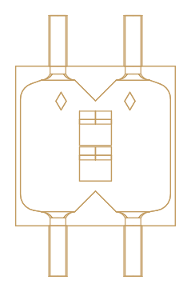
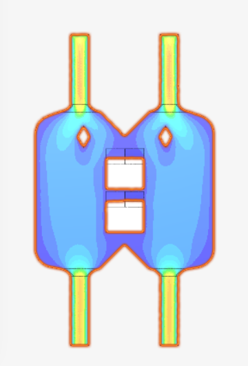

# Liquid Distribution Plate

Design module team project at UCD. The brief was a 500 × 500 mm plate that splits a flow of water evenly across its inside, with no dead zones, few preferred channels, and as little of the plate's inner area taken up as possible. Every design was tested with steady-state CFD in SimScale.

Full write-up: [case study on my portfolio](https://portfolio.zaidsniaz.workers.dev/projects/liquid-distribution-plate)

  
  

**Final design:** two small split elements in the weakest strip of the plate. The mixing score in that strip rose from 0.05 to about 0.35, with no extra pressure drop and the slow-flow zone kept to 7.5%.

Mixing score runs from 0 (the two streams stay separate) to 1 (perfectly even).

## Key designs (`key-designs/`)

| File | Design | Notes |
| --- | --- | --- |
| [`1-early-pin-and-vane-concept.step`](key-designs/1-early-pin-and-vane-concept.step) | Early pin-and-vane concept | Designed with the wrong fluid properties, so far more complex than water needs. |
| [`2-coat-hanger.step`](key-designs/2-coat-hanger.step) | Coat-hanger | Won the first round of SimScale tests at 300 mm. |
| [`3-twin-inlet-baseline.step`](key-designs/3-twin-inlet-baseline.step) | Twin-inlet baseline | Plain plate, 200 × 200 mm. Mixing score 0.01; everything else is compared to it. |
| [`4-split-and-recombine.step`](key-designs/4-split-and-recombine.step) | Split and recombine | Full-width split that swaps the two streams. Best overall mixing score, 0.44. |
| [`5-final-design-two-split-elements.step`](key-designs/5-final-design-two-split-elements.step) | **Final design** | Two small split elements in the weakest strip. |
| [`6-final-design-print-version.stl`](key-designs/6-final-design-print-version.stl) | Final design, print version | Print-ready mesh. Click it to view in 3D. |
| [`7-final-design-all-parts.step`](key-designs/7-final-design-all-parts.step) | Final design, all nine parts | Body, base plate, insert, two split elements and four ports. |

## All other iterations (`all-iterations/`)

| File | Design | Notes |
| --- | --- | --- |
| `01-early-base-version.step` | Base version | Starting point. |
| `02-early-v2.step` | Version 2 | |
| `03-early-tight-vanes.step` | Tight guide vanes | Early series, wrong fluid properties. |
| `04-early-graded-pins.step` | Graded pin field | Early series, wrong fluid properties. |
| `05-early-corner-fix-splitter.step` | Corner fix and splitter | Early series, wrong fluid properties. |
| `06-early-curved-shoulders.step` | Curved shoulders | Early series, wrong fluid properties. |
| `07-twin-inlet-300mm.step` | Twin inlet, 300 mm | Came second in the first SimScale round; source of the twin-inlet layout. |
| `08-twin-inlet-opposing-ribs.step` | Opposing half-round ribs | Best of the rib designs, mixing score 0.09. |
| `09-twin-inlet-staggered-herringbone-ribs.step` | Staggered herringbone ribs | Most complex rib layout; not much better than opposing ribs. |
| `10-twin-inlet-tall-herringbone-ribs.step` | Tall herringbone ribs, back face only | Worse mixing (0.05); slow zone up to 10.5%. |
| `11-twin-inlet-dead-zones-filled.step` | Corners and V's filled | Slow zone 7.3% to 6.8%. |
| `12-twin-inlet-three-split-elements.step` | Three split elements | Beaten by the two-element final design. |

## What I learned

- Get the real fluid properties before designing around a simulation.
- For a low-viscosity fluid, simple geometry in the right place beats complex features everywhere.
- Fewer, targeted elements can beat more of them: two split elements beat three.
