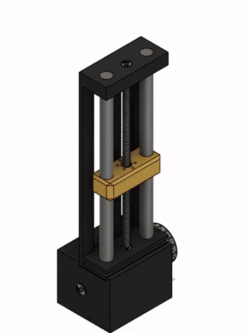
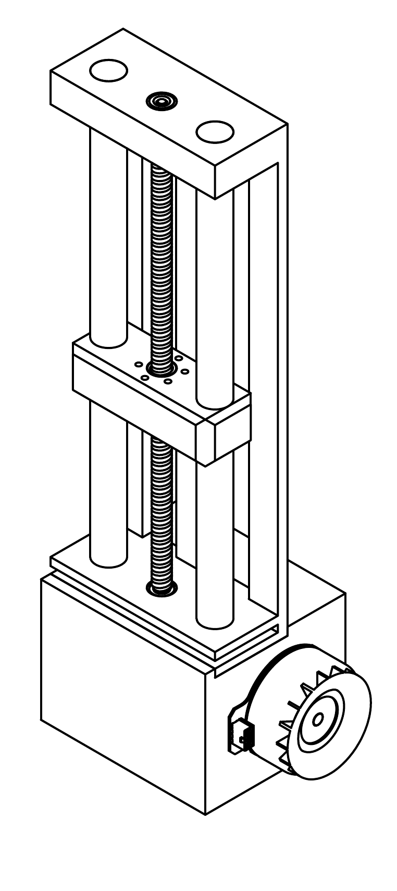

# Tensile Tester Drive

Mechanical Engineering Design I at UCD. Each member of our group designed a different drive for the same machine, then we compared them. This is my design: the drive system for a uniaxial tensile tester, modelled and animated in Autodesk Fusion.

Full write-up: [case study on my portfolio](https://zaidsniaz.com/projects/tensile-tester)

  
  

## Brief against design

| | Brief | My design |
| --- | --- | --- |
| Pulling force | 10 kN | 10.5 kN |
| Speed | 50 mm/s | 50 mm/s |
| Travel | 300 mm or more | 400 mm ball screw |

## Drive train

1. **Motor:** catalogue motor at 36 V, 1.62 N·m at about 4,280 rpm.
2. **Worm drive:** single-start worm and 10-tooth wheel. 10:1 reduction, turning the drive through 90°. Assumed 80% efficient.
3. **Ball screw:** Ø15 × 400 mm, 7 mm lead. Assumed 90% efficient.
4. **Crosshead:** driven by the ball nut, running on two guide rods.

Force = 1.62 N·m × (10 × 0.8) × (2π ÷ 0.007 m × 0.9) ≈ 10.5 kN
Speed = 448 rad/s ÷ (10 × 2π ÷ 0.007 m) ≈ 50 mm/s
Overall efficiency 72%.

## Files

| File | What it is |
| --- | --- |
| [`drawing-package.pdf`](drawing-package.pdf) | Four sheets: general assembly with parts list, worm, gear and shaft, upper base. |
